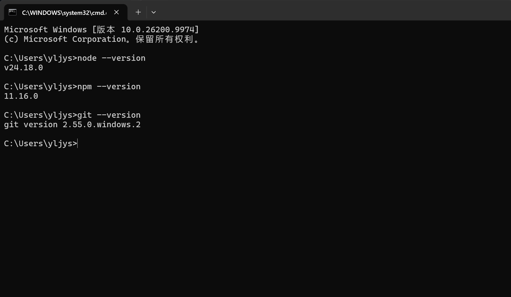
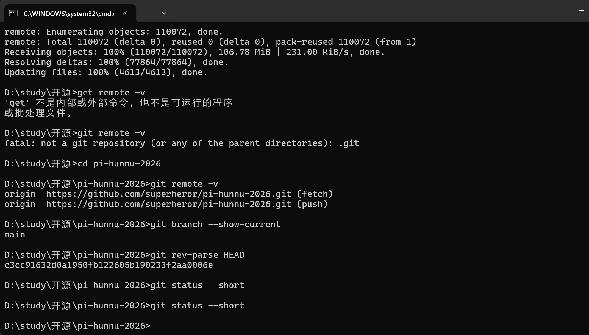
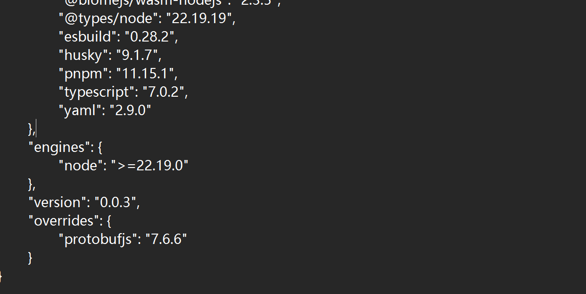
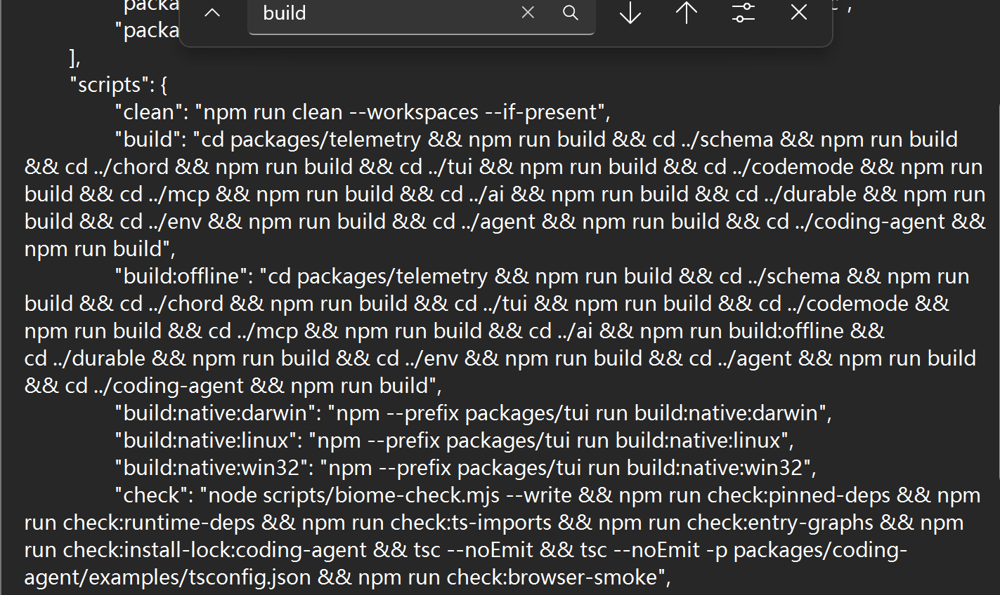
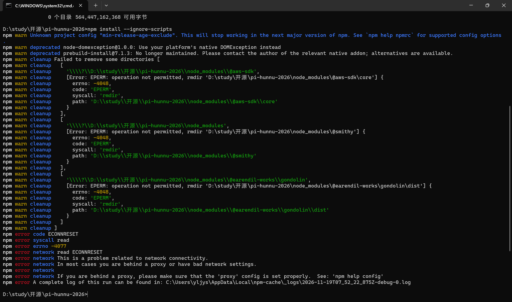
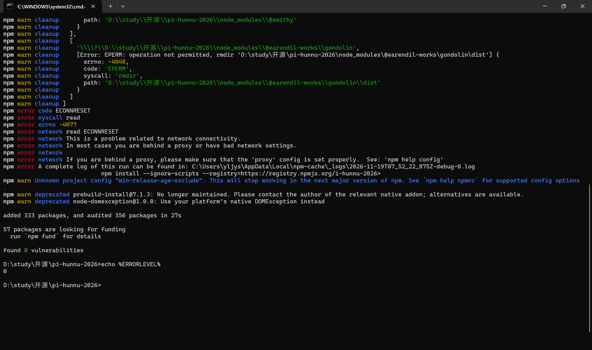
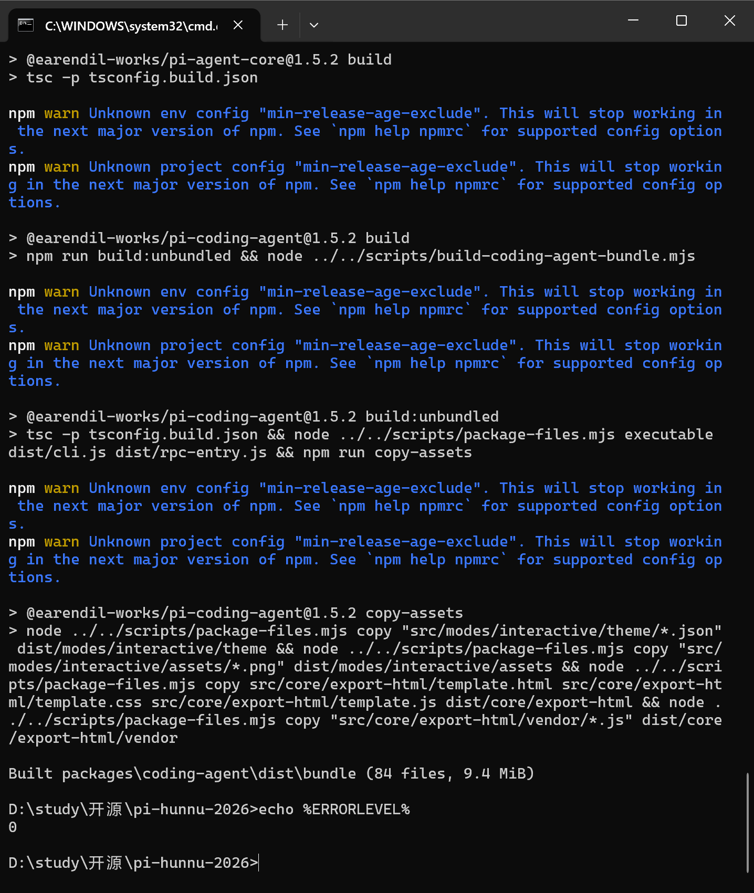
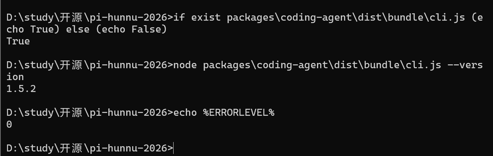
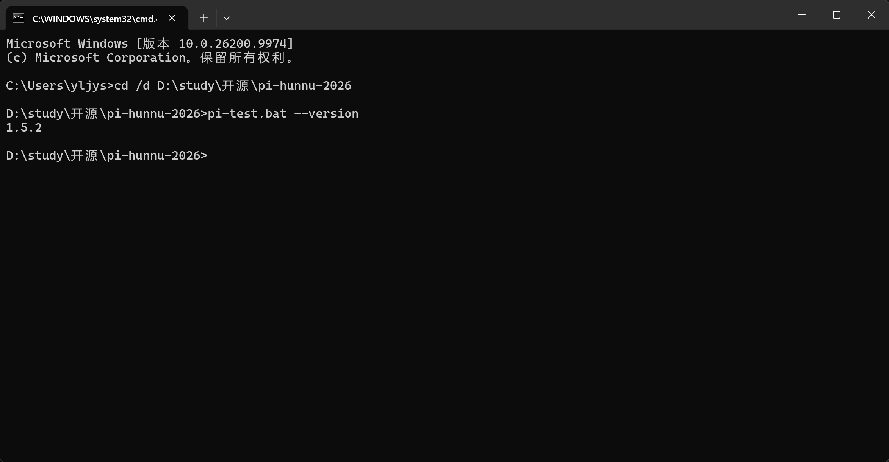
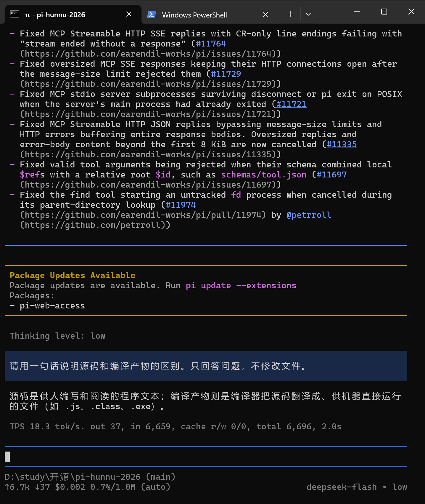

# 实践课3：Pi Agent 源码安装与编译

> 姓名：阳凌杰
> 学号：202430224046  
> 实验环境：Windows；Node.js v24.18.0；npm 11.16.0；Git 2.55.0.windows.2

## 一、实验目标与源码版本

本次实验使用第二次实践课的小组组织仓库 `superheror/pi-hunnu-2026`，本地路径为 `D:\study\开源\pi-hunnu-2026`，分支为 `main`，提交号为 `c3cc91632d0a1950fb122605b190233f2aa0006e`。检查时 `git status --short` 无输出，说明受 Git 跟踪的文件没有未提交修改。

## 二、阅读项目配置

根目录 `package.json` 的 `engines.node` 为 `>=22.19.0`；当前 Node.js v24.18.0 满足这一要求。根配置通过 `workspaces` 管理多个子包；`package-lock.json` 锁定依赖版本。执行 `npm run build` 时，npm 读取根目录 `package.json` 的 `scripts.build`，按脚本顺序进入各子包并调用各包的构建脚本。`&&` 表示前一步成功才继续。

## 三、安装依赖与问题处理

在源码仓库根目录运行 `npm install --ignore-scripts`。该命令依据根配置和锁文件安装项目依赖，建立本地 `node_modules` 并关联工作区包；`--ignore-scripts` 跳过安装期间自动运行的生命周期脚本，不妨碍之后主动执行 `npm run build`。由于没有 `-g`，此操作不会把本地源码安装为全局 `pi` 命令。

首次安装出现 `ECONNRESET`，下载依赖的网络连接被重置，安装未完成。日志中另有 `deprecated` 和清理目录时的 `EPERM` 警告；这些提示需要记录，但本次失败的直接错误是 `ECONNRESET`。当时 npm 配置的仓库地址为 `https://registry.npmmirror.com`。随后仅对重试命令指定官方源：`npm install --ignore-scripts --registry=https://registry.npmjs.org/`。重试新增 333 个包、审计 356 个包，报告 0 个已知漏洞，退出码为 0。这里的审计结果仅说明该次审计没有报告已知漏洞，不代表构建已经成功。

## 四、源码构建和产物验证

在仓库根目录执行 `npm run build`。根脚本依次构建多个子包，最后生成 `packages\coding-agent\dist\bundle`（日志显示 84 个文件、约 9.4 MiB），整个命令退出码为 0。首次构建涉及联网获取模型目录配置数据，并非下载大模型权重。

检查 `packages\coding-agent\dist\bundle\cli.js`，文件存在；执行 `node packages\coding-agent\dist\bundle\cli.js --version` 输出 `1.5.2`，退出码为 0。因此既有完整构建成功的证据，也有本地构建产物可以运行的证据。`src` 是供修改和开发的源码，`dist` 是构建生成的产物；修改程序应改 `src` 后重新构建。

## 五、运行本地源码并完成会话

在源码根目录执行 `pi-test.bat --version`，输出 `1.5.2`；再执行 `pi-test.bat` 启动交互界面，输入“请用一句话说明源码和编译产物的区别。只回答问题，不修改文件。”，实际收到模型回复。由此确认本地源码入口能够启动，并且本次模型会话成功。

本次通过仓库根目录的 `pi-test.bat` 启动，而非直接输入可能指向全局安装版本的 `pi`，以确定运行的是本地源码入口。该脚本最终运行 `packages/coding-agent/src/cli.ts`，适合源码开发与调试；`dist/bundle/cli.js` 是构建后的 CLI 入口，适合验证和运行构建产物。两者均显示版本 `1.5.2`，但版本号相同本身不能代替入口路径和构建日志的证明。

## 六、实验总结

本次实验确认了源码来源和完整提交号，在仓库根目录安装依赖、按根脚本完成构建，并分别验证了构建产物和源码入口。遇到的主要困难是首次依赖安装时网络连接重置；改用官方 npm 仓库进行单次重试后安装成功。
